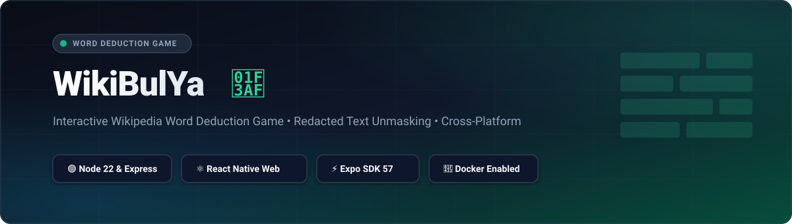
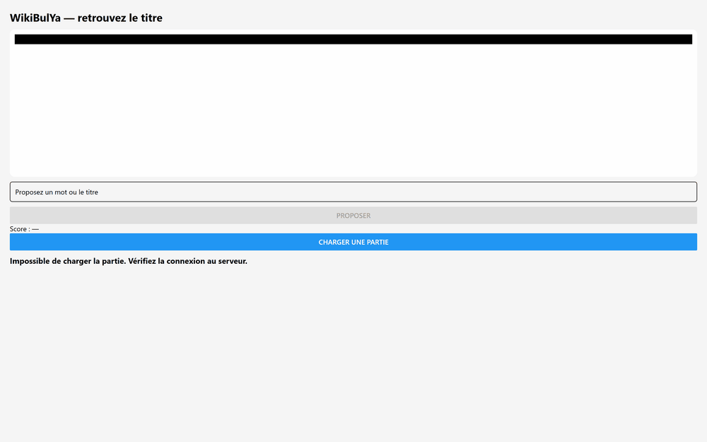
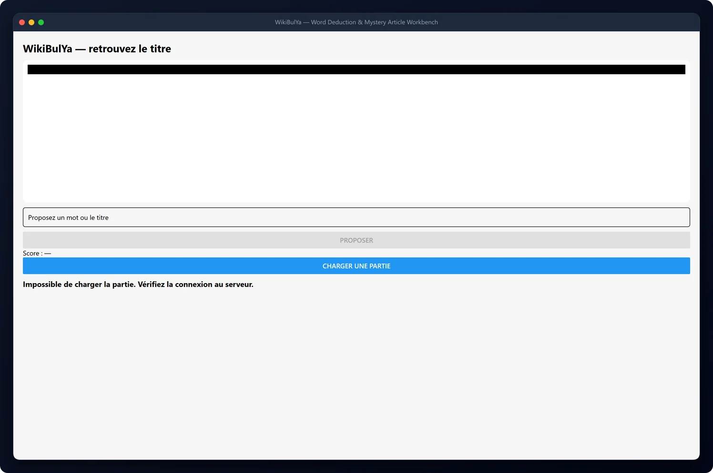
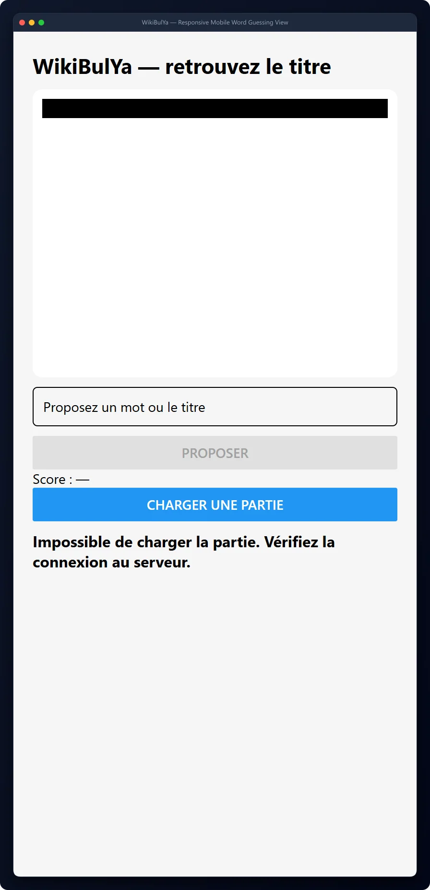
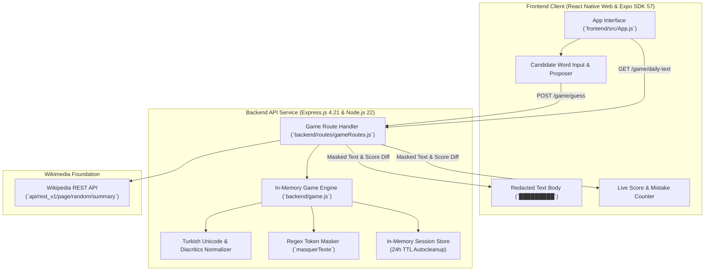

<div align="center">



# WikiBulYa 🎯

[](https://nodejs.org/)
[](https://expressjs.com/)
[](https://expo.dev/)
[](https://necolas.github.io/react-native-web/)
[](https://www.docker.com/)
[](LICENSE)

**An interactive word deduction and trivia guessing game inspired by Redactle and Contexto, built around Wikipedia article summaries.**

[Overview](#overview) • [Live Demo](#live-demo) • [Screenshots](#screenshots) • [Key Highlights](#key-highlights--mechanics) • [Architecture](#architecture) • [Install & Configure](#how-to-install--configure) • [How to Use](#how-to-use) • [Create & Customize](#how-to-create--customize) • [API Reference](#api-reference) • [Verification](#verification--testing) • [License](#license)

</div>

---

## Overview

**WikiBulYa** challenges players to uncover redacted Wikipedia article summaries by submitting candidate words. Players start with 10,000 points, deduce hidden themes through vocabulary association, and unmask the mystery article title with minimal penalties.

Features built-in Turkish diacritics and Unicode normalization, zero database requirement via an in-memory game engine, and a fully cross-platform React Native Web responsive interface.

---

## Live Demo

<div align="center">



*Submitting candidate words, instant unmasking of matched tokens, score deductions, and mobile responsive play.*

</div>

---

## Screenshots

<table width="100%">
  <tr>
    <td width="50%" align="center">
      <b>Desktop Word Deduction Interface</b><br/><br/>
      
    </td>
    <td width="50%" align="center">
      <b>Mobile Responsive Guessing View</b><br/><br/>
      
    </td>
  </tr>
</table>

---

## Key Highlights & Mechanics

- **Redacted Article Discovery:** Uncovers masked Wikipedia summaries (`█████████`) piece by piece as valid vocabulary words are identified.
- **Turkish Unicode & Accent Normalization:** Accurate handling of Turkish diacritics (`ç, ğ, ı, ö, ş, ü, İ, I`) and case folding ensures seamless word matching regardless of capitalization.
- **Score Calculation & Penalty:** Players start with 10,000 points. Correct guesses unmask matching tokens across the entire article, while incorrect guesses deduct 100 points. Duplicate guesses are idempotent and do not penalize twice.
- **Lightweight Architecture:** Zero database requirement for standard single-player gameplay — the backend runs an in-memory game engine with automatic 24-hour session cleanup.
- **Cross-Platform Delivery:** Runs anywhere via Expo and React Native Web (desktop browsers, iOS, Android, and mobile web).

---

## Architecture



---

## How to Install & Configure

### Prerequisites

- [Node.js](https://nodejs.org/) (v20 or higher recommended, Node.js 22+ supported)
- [npm](https://www.npmjs.com/) (v10+ recommended)
- Optional: [Docker](https://www.docker.com/) and Docker Compose for containerized execution

### Step 1: Clone the Repository

```bash
git clone https://github.com/Emincanozen/wikibulya.git
cd wikibulya
```

### Step 2: Configure Environment Variables

1. **Backend Environment:**
   ```bash
   cp backend/.env.example backend/.env
   ```
   Default parameters in `backend/.env`:
   - `PORT=5000`
   - `CORS_ORIGIN=http://localhost:8081`

2. **Frontend Environment:**
   ```bash
   cp frontend/.env.example frontend/.env
   ```
   Default parameters in `frontend/.env`:
   - `EXPO_PUBLIC_API_URL=http://localhost:5000`

### Step 3: Install Dependencies

```bash
# Install backend dependencies
cd backend
npm install
cd ..

# Install frontend dependencies
cd frontend
npm install
cd ..
```

---

## How to Use

### Option A: Local Development Workflow

1. **Start the Backend API:**
   ```bash
   cd backend
   npm start
   ```
   The backend API will listen on `http://localhost:5000`.

2. **Start the Frontend Web Client:**
   In a separate terminal:
   ```bash
   cd frontend
   npm run web
   ```
   The interactive interface will launch in your browser at `http://localhost:8081` (or your configured Expo port).

3. **Playing the Game:**
   - Review the redacted article text.
   - Enter candidate words into the input field and press **Proposer** (Submit).
   - Watch discovered words reveal themselves in the text body.
   - Enter the full article title to solve the mystery and claim victory!

### Option B: Docker Container Deployment

Run the entire stack in isolated Docker containers:

```bash
docker compose -f docker/docker-compose.yml up --build
```

- **Frontend Client:** `http://localhost:8081`
- **Backend API:** `http://localhost:5000`

---

## How to Create / Customize

WikiBulYa is designed for easy modification, whether you want to change the article source language, adjust difficulty heuristics, or style the interface.

### 1. Changing the Wikipedia Source Language or Endpoint

The article retriever is injected into the route builder in `backend/routes/gameRoutes.js`. To switch from Turkish to English, French, or another Wikimedia edition, update the API URL:

```javascript
// backend/routes/gameRoutes.js
chargerArticle: async () => {
    // Example: switch 'tr.wikipedia.org' to 'en.wikipedia.org' or 'fr.wikipedia.org'
    const { data } = await axios.get(
        'https://en.wikipedia.org/api/rest_v1/page/random/summary',
        { timeout: 10000, maxContentLength: 1024 * 1024 }
    );
    return { title: data.title, summary: data.extract };
}
```

### 2. Customizing Scoring Rules & Masking

Scoring and text masking logic reside in `backend/game.js`:
- **Initial Score:** Update `score: 10000` in `commencer()`.
- **Penalty per Miss:** Change `-100` penalty in `deviner(session_token, word)`.
- **Masking Character:** Replace `█` with `_`, `*`, or custom redaction tokens.

```javascript
// backend/game.js
function masquerTexte(texte, motsTrouves) {
    return texte.replace(/\p{L}+/gu, (mot) => {
        const motNormalise = normaliser(mot);
        return motsTrouves.has(motNormalise) ? mot : '█'.repeat(mot.length);
    });
}
```

### 3. Styling & Theming the Frontend

The client interface is defined in `frontend/src/App.js`:
- **Theme & Colors:** Customize `styles.container` background color, card radii, and fonts.
- **Redaction Box Styling:** Tweak `styles.hiddenText` (e.g., monospace typography or letter-spacing).
- **Localization:** Update user-facing prompt labels from Turkish/French to English or your target audience.

---

## API Reference

### `GET /game/daily-text`
Retrieves or initiates a game session with the current masked Wikipedia summary.

```json
{
  "session_token": "a1b2c3d4-e5f6-7890-abcd-ef1234567890",
  "text": "█████████, ████████ ███ ██████.",
  "score": 10000,
  "won": false
}
```

### `POST /game/guess`
Submits a candidate word or title guess.

**Request:**
```json
{
  "session_token": "a1b2c3d4-e5f6-7890-abcd-ef1234567890",
  "guessed_word": "tarih"
}
```

**Response:**
```json
{
  "session_token": "a1b2c3d4-e5f6-7890-abcd-ef1234567890",
  "text": "█████████, tarihte ███ ██████.",
  "score": 10000,
  "won": false,
  "isCorrect": true
}
```

---

## Verification & Testing

```bash
# Run backend test suite
cd backend
npm test

# Run frontend web export validation
cd ../frontend
npm run build:web
```

---

## License

This project is open-source software licensed under the [MIT License](LICENSE).
